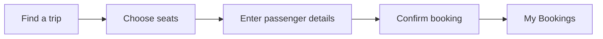

# Bus-Booking

A Vue 3 bus-booking frontend built with Vite, TypeScript, Vue Router, and Pinia.

## Booking concept and workflow

The application separates trip information, the current booking, and reusable interface elements:

- **Trip service** (`src/services/tripService.ts`) defines the `Trip` type and the shared list of sample trips. The trip list imports the list, while the details, seat selection, passenger information, and confirmation pages use `getTrip(id)` to find the same trip.
- **Booking store** (`src/stores/bookingStore.ts`) holds the current trip ID, travel date, passenger count, selected seats, total, passenger details, and contact information. Pinia makes this state available across pages. The store saves it to session storage and restores it on refresh; `clear()` removes the pending booking after confirmation.
- **Reusable components** (`src/components/`) keep shared markup in one place. `Navbar.vue` provides navigation, `BookingSteps.vue` displays the current stage, and `SeatMap.vue` displays seat and list views and emits seat selections to its parent.

### How the pieces connect

The views manage each page and user action. They read common trip details from the service and share the active booking through the Pinia store. The components receive data from their parent view and render reusable parts of the interface; the seat map emits a selection event so the seat page can validate and save the change.



The trip service supplies trip details throughout the flow. The booking store keeps the selected seats and passenger information available between pages and after a refresh. Confirmed bookings appear in My Bookings.

### Step-by-step flow

The booking flow works as follows:

1. **Find a trip:** The trip list displays and filters trips from the service. A selected travel date is carried to the trip details page.
2. **Review trip details:** The details page looks up the trip by its route ID. When the user chooses the passenger count and continues, the store starts or reuses a pending booking.
3. **Select seats:** The seat selection page reads the trip and pending booking. `SeatMap` reports seat clicks to the page, which checks availability and the passenger limit and updates the store.
4. **Enter passenger information:** The passenger page reads the selected seats from the store, validates passenger and contact information, and saves it back to the store.
5. **Confirm the booking:** The payment page reads the trip and booking, validates the details, and saves the submitted booking to browser local storage. It then clears the pending booking from the store. The user can view saved bookings on the My Bookings page.

Trip data and occupied seats are currently sample data. Confirmation is a frontend prototype: it records a pending, unpaid booking in the browser and does not process payment or reserve a seat with an operator.


## Recommended IDE Setup

[VS Code](https://code.visualstudio.com/) + [Vue (Official)](https://marketplace.visualstudio.com/items?itemName=Vue.volar) (and disable Vetur).

## Recommended Browser Setup

- Chromium-based browsers (Chrome, Edge, Brave, etc.):
  - [Vue.js devtools](https://chromewebstore.google.com/detail/vuejs-devtools/nhdogjmejiglipccpnnnanhbledajbpd)
  - [Turn on Custom Object Formatter in Chrome DevTools](http://bit.ly/object-formatters)
- Firefox:
  - [Vue.js devtools](https://addons.mozilla.org/en-US/firefox/addon/vue-js-devtools/)
  - [Turn on Custom Object Formatter in Firefox DevTools](https://fxdx.dev/firefox-devtools-custom-object-formatters/)

## Type Support for `.vue` Imports in TS

TypeScript cannot handle type information for `.vue` imports by default, so we replace the `tsc` CLI with `vue-tsc` for type checking. In editors, we need [Volar](https://marketplace.visualstudio.com/items?itemName=Vue.volar) to make the TypeScript language service aware of `.vue` types.

## Customize configuration

See [Vite Configuration Reference](https://vite.dev/config/).

## Project Setup

```sh
npm install
```

### Compile and Hot-Reload for Development

```sh
npm run dev
```

### Type-Check, Compile and Minify for Production

```sh
npm run build
```

### Lint with [ESLint](https://eslint.org/)

```sh
npm run lint
```
